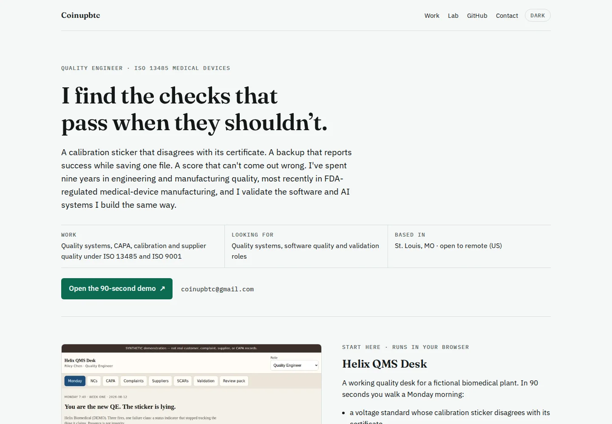

# coinupbtc.com



Source for **[coinupbtc.com](https://coinupbtc.com/)**, the hiring homepage for Coinupbtc: a quality engineer in ISO 13485 medical-device manufacturing who validates software and local AI systems the same way.

## What's on the page

- **Helix QMS Desk** first, the 90-second browser demo ([repo](https://github.com/Coinupbtc/helix-qms-desk)).
- **Case files** written like corrective actions (found, root cause, fix, verified). Each links its public evidence, or says plainly when the evidence is private.
- **The lab**: two NVIDIA DGX Spark machines, with links to [coinupbtc.xyz](https://coinupbtc.xyz/) and the public repos.
- Skills and contact.

## Run it locally

```bash
git clone https://github.com/Coinupbtc/Coinupbtc.github.io.git
cd Coinupbtc.github.io && ./setup.sh
```

Or open `index.html` in a browser. There is no build step.

## How it's built

- One HTML file with inline CSS and a few lines of JavaScript for the theme toggle.
- Fonts: Fraunces (headings), IBM Plex Sans (body), IBM Plex Mono (labels), from Google Fonts.
- Follows the visitor's light or dark setting. No trackers, cookies or analytics.
- `.github/workflows/` publishes only the site files (`index.html`, `resume/`, `assets/`, `CNAME`, `robots.txt`, `sitemap.xml`) to GitHub Pages on every push to `main`.
- Share card: `scripts/og-card.html`, rendered to `assets/og-image.png` by `scripts/export-og.sh`.

## Identity

The site uses the handle **Coinupbtc** only: no real name, employer, phone or street address.
Contact: coinupbtc@gmail.com · [GitHub](https://github.com/Coinupbtc) · [X @coinupbtc](https://x.com/coinupbtc).
